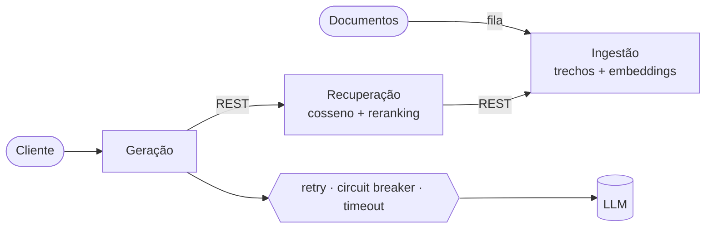

### Levo IA do notebook à produção.

---

## Em 30 segundos

- **Coloquei um produto com LLM em produção.** O [Letters](https://github.com/Andre-Quintela/Letters) corrige redações com Azure OpenAI e está no ar, com [demo](https://letterspi.azurewebsites.net/) e [vídeo](https://youtu.be/RH9m-NrcWZk).
- **Construí um RAG distribuído que não cai junto com o LLM.** São 3 microsserviços com Redis Streams, circuit breaker, retry e timeout, cobertos por 15 testes automatizados.
- **Treino e avalio modelos** de visão computacional (ResNet-50, CNN), NLP (BERT) e sistemas de recomendação (SVD).
- **Tenho base sólida de engenharia de software:** trabalho com C#, .NET e Angular em Clean Architecture. Por isso penso em IA como *sistema* — confiável, testável e útil para quem usa.

---

## Destaque: RAG distribuído que continua de pé quando o LLM cai

> [`C2-Howard`](https://github.com/Andre-Quintela/C2-Howard) · Python · FastAPI · Redis Streams · Docker · pytest

| Problema | Decisão |
|---|---|
| O LLM é lento e instável | Fila também nas perguntas: workers assíncronos que escalam horizontalmente |
| Mensagem pode se perder numa falha | Sem `ACK` em falha: a mensagem volta para a fila, até 3 tentativas |
| LLM fora do ar | Disjuntor aberto → `503` **com os trechos recuperados**, sem esperar timeout |
| Busca sem contexto relevante | Não chama o LLM: evita custo e alucinação |

---

## As duas frentes da engenharia de IA

<table>
<tr>
<td width="50%" valign="top">

### Engenharia de software com foco em IA

| Projeto | O que mostra |
|---|---|
| [**Letters**](https://github.com/Andre-Quintela/Letters) | LLM integrado a um produto web em produção (.NET 8, Angular, Azure OpenAI, Azure SQL) |
| [**RAG Distribuído**](https://github.com/Andre-Quintela/C2-Howard) | Resiliência em volta do LLM em microsserviços |
| [**Inferência Distribuída**](https://github.com/Andre-Quintela/sd-2026-2-kit-c1a2) | Modelo servido por REST **e** gRPC, com fila Redis e workers |

</td>
<td width="50%" valign="top">

### Engenharia de IA e Machine Learning

| Projeto | O que mostra |
|---|---|
| [**Food Classification**](https://github.com/Andre-Quintela/Food-Classification) | Fine-tuning de ResNet-50 em 41 classes de pratos (PyTorch) |
| [**Sentimento em Avaliações**](https://github.com/Andre-Quintela/NLP-ANALISE-DE-SENTIMENTOS) | BERT em português, insights por aspecto |
| [**Recomendador de Restaurantes**](https://github.com/Andre-Quintela/Recomendador-De-Restaurantes) | Recomendação híbrida: conteúdo + SVD |
| [**Detecção de Capacete**](https://github.com/Andre-Quintela/CNN-Motoqueiros-sem-capacetes) | CNN para visão computacional |
| [**House Prices**](https://github.com/Andre-Quintela/House-Prices---Machine-Learning-Hackathon) | Competição do Kaggle de ponta a ponta |

</td>
</tr>
</table>

### IA no universo da comida

Três dos meus projetos nasceram do mesmo domínio — **comida e restaurantes**:

- **Classificar** o prato pela foto
- **Entender** o que os clientes dizem nas avaliações
- **Recomendar** o próximo restaurante

É um domínio onde dados e IA mudam a experiência de muita gente todos os dias.

---

## Como eu construo sistemas com IA

| | |
|---|---|
| **Planejo para quando der errado** | Timeout, retry com backoff e jitter, circuit breaker e degradação elegante |
| **Meço antes de confiar** | Separação treino/validação, métricas (acurácia, R², RMSE), avaliação automática das respostas do RAG e testes |
| **Segredo não vai pro código** | `user-secrets` e `.env`, além de modo simulado para rodar sem chave de API |
| **IA a serviço do usuário** | O modelo é uma parte; o valor aparece quando ele vira produto |

---

## Stack

**LLMs & Machine Learning**

**Servir IA em produção**

**Engenharia de software**

---

---

### Vamos construir IA que gera impacto?

Estou aberto a oportunidades em **engenharia de IA**.
O jeito mais rápido de conhecer meu trabalho é o **[portfólio](https://andre-quintela.github.io)**.

